<div align="center">

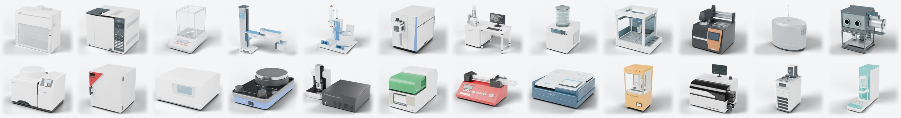

# ChemLab-Assets

**198 simulation-ready chemistry laboratory instruments**<br>
part-level geometry · working joints · executable behaviour models · machine-readable contracts

<a href="https://mbzuai-nlp.github.io/ChemLab-Assets/"></a>
<a href="https://huggingface.co/datasets/MBZUAI/ChemLab-Assets"></a>
<a href="https://huggingface.co/spaces/MBZUAI/ChemLab-Assets-Explorer"></a>


Zirui Song · Jiadong Zhang · Jiahao Zhang · Xiaosong Ma · Xiaojun Chang · Xiuying Chen<br>
Mohamed bin Zayed University of Artificial Intelligence (MBZUAI)

**English** · [中文](README_zh.md)

</div>

## News

- **[2026-10-15] v1.1 released.** More instruments now return results based on real published data instead of placeholder values:
  - 18 new reference-data libraries (e.g. GC, IR, NMR, XRD, titration) and 32 expanded ones.
  - A shared table of 200 common compounds, linked to the instruments that can measure each of them.
  - 38 built-in chemical reactions (up from 8) for heating and reaction equipment.
- **[2026-10-14] v1.0 released.** 198 simulation-ready laboratory instruments.

## Overview

Agents that work in a chemistry lab need more than meshes. They need to know that a fume-hood sash travels 673 mm and
stops at 457 mm, that moving a balance's draft-shield door restarts its stability check, and which quantities a policy
may observe and which are hidden ground truth kept for evaluation. ChemLab-Assets ships that knowledge with the geometry.

Each asset is one specific commercial instrument, chosen from a survey of 200 instruments and modules used in university
chemistry teaching and research, and built from published brochures, manuals and papers. The models reproduce documented
behaviour; they are not manufacturer CAD and have not been calibrated against physical units.

This repository holds the code (runtimes, tests, examples, contract validator), the catalog, the project website (`docs/`) and the 3D explorer (`explorer/`). The models and data (about 1.5 GB) live in the [Hugging Face dataset](https://huggingface.co/datasets/MBZUAI/ChemLab-Assets); `python tools/download_assets.py` fetches them into `assets/`.

## At a glance

| | |
|---|---|
| **Instruments** | 198 commercial models from 115 manufacturers, in 16 capability domains |
| **Geometry** | GLB, URDF with primitive collision proxies, 14,492 per-part OBJ meshes, Blender sources |
| **Articulation** | 1,328 joints (909 prismatic, 388 revolute, 31 continuous): doors, sashes, lids, keys and knobs |
| **Contracts** | 14,272 components, 6,282 typed state slots, 4,701 capabilities with JSON-Schema arguments and declared errors |
| **Interfaces** | 648 readouts (displays, LEDs) and 2,348 interface points (place, grasp, ports) |
| **Behaviour** | a Python runtime per instrument: time-stepped process models behind `describe` / `read` / `invoke` / `poll`, agent and evaluator views, seeded noise |
| **Provenance** | 3,382 cited sources; raw third-party documents are not redistributed |
| **Simulation** | all 198 converted to USD and stepped in NVIDIA Isaac Lab through the Matterix framework |

## Gallery

<table>
<tr><td align="center" width="25%">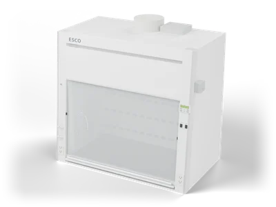<br><sub><b>Chemical fume hood</b><br>Esco Lifesciences Frontier Acela EFA-5UDUVW-9</sub></td><td align="center" width="25%">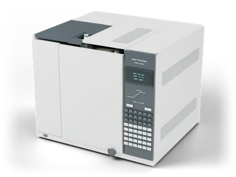<br><sub><b>Gas chromatograph (S/SL inlet + FID)</b><br>Agilent 7890B</sub></td><td align="center" width="25%">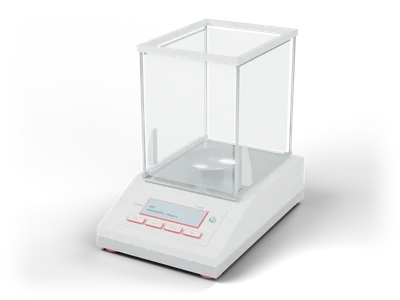<br><sub><b>Analytical balance</b><br>METTLER TOLEDO XPR204E</sub></td><td align="center" width="25%">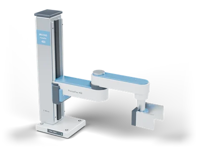<br><sub><b>Lab sample-transfer robot arm</b><br>Brooks Automation PreciseFlex 400</sub></td></tr>
<tr><td align="center" width="25%">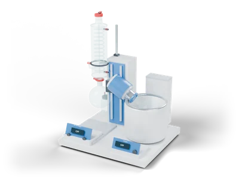<br><sub><b>Rotary evaporator</b><br>IKA RV 10 digital V</sub></td><td align="center" width="25%">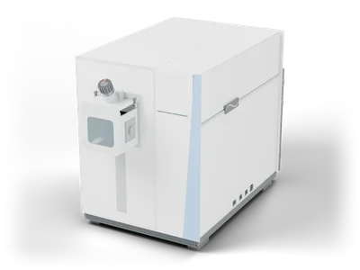<br><sub><b>High-resolution Orbitrap mass spectrometer</b><br>Thermo Fisher Scientific Orbitrap Exploris 120</sub></td><td align="center" width="25%">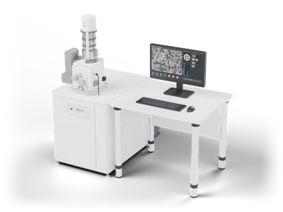<br><sub><b>Scanning electron microscope</b><br>JEOL JSM-IT200 LA</sub></td><td align="center" width="25%">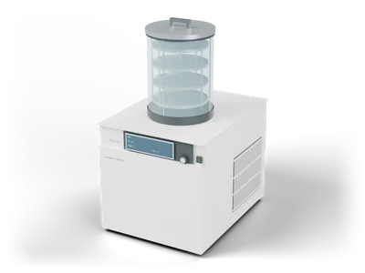<br><sub><b>Freeze dryer</b><br>BUCHI Lyovapor L-250 Pro</sub></td></tr>
<tr><td align="center" width="25%">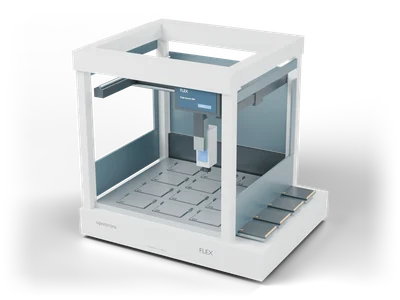<br><sub><b>Automated liquid-handling robot</b><br>Opentrons Flex (1-channel 5–1000 µL)</sub></td><td align="center" width="25%">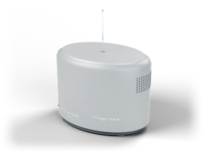<br><sub><b>Benchtop NMR spectrometer</b><br>Magritek Spinsolve 80 Carbon</sub></td><td align="center" width="25%">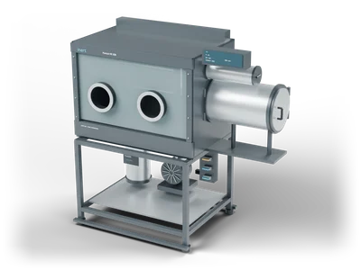<br><sub><b>Inert-atmosphere glovebox</b><br>Inert PureLab HE 2GB</sub></td><td align="center" width="25%">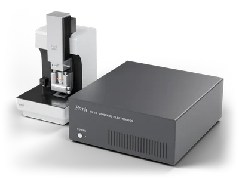<br><sub><b>Atomic force microscope</b><br>Park Systems NX10</sub></td></tr>
</table>

Browse all 198 in 3D, with joint sliders and part-by-part annotations, in the [3D explorer](https://huggingface.co/spaces/MBZUAI/ChemLab-Assets-Explorer).

## Instruments by domain

| Domain | Instruments | Examples |
|---|---:|---|
| Thermal, Mechanical & Transport | 23 | Pin-on-disk tribometer (Anton Paar TRB³); Coating scratch tester (Anton Paar RST 300); Nanoindentation tester (Anton Paar HIT 300) |
| Basic Metrology & Sample Handling | 16 | Analytical balance (METTLER TOLEDO XPR204E); Halogen moisture analyzer (METTLER TOLEDO HX204); Oscillating U-tube density meter (Anton Paar DMA 5002) |
| Lab Environment & Utilities | 16 | Muffle furnace (Nabertherm L 9/11/SKM); Tube furnace (controlled atmosphere) (Carbolite Gero TF1 12/60/300); Heating/refrigerated circulator (JULABO CORIO CD-200F) |
| Extraction, Purification & Drying | 15 | Rotary evaporator (IKA RV 10 digital V); Freeze dryer (BUCHI Lyovapor L-250 Pro); Lab spray dryer (BUCHI Mini Spray Dryer S-300) |
| Particles, Pores & Interfaces | 15 | Solid-surface streaming-potential analyzer (Anton Paar SurPASS 3); Gas pycnometer (true density) (Anton Paar Ultrapyc 5000); Gas physisorption surface-area & pore analyzer (Anton Paar Autosorb 6100) |
| Molecular Spectroscopy & Structure | 14 | Circular dichroism spectrometer (JASCO J-1500); Time-domain NMR relaxometer (Bruker minispec mq20); Spectrofluorometer (JASCO FP-8350) |
| Digestion & Solid Sample Prep | 13 | Graphite block digestion system (SCP SCIENCE DigiPREP MS); Planetary ball mill (RETSCH PM 100); Vibratory sieve shaker (RETSCH AS 200 control) |
| Thin-Film & Functional Materials | 13 | Vibrating-nozzle encapsulator (BUCHI Encapsulator B-390); Spin coater (Ossila Spin Coater V3); Dip coater (Ossila Dip Coater V2) |
| Elemental & Mass Spectrometry | 12 | Organic elemental (CHNS) analyzer (Elementar vario EL cube); Total organic carbon analyzer (Shimadzu TOC-L CSH); Atomic absorption spectrometer (Analytik Jena contrAA 800 D) |
| Microscopy, Imaging & Diffraction | 12 | Scanning electron microscope (JEOL JSM-IT200 LA); Transmission electron microscope (JEOL JEM-1400Flash); Small-angle X-ray scattering system (Anton Paar SAXSpace) |
| Biochemical & Wet-Chemistry Assays | 11 | Microplate washer (Agilent BioTek 405 TS (96-tube manifold)); Gel electrophoresis system (Bio-Rad Mini-PROTEAN Tetra + power supply); Gel & blot imager (Thermo Fisher Scientific iBright FL1500) |
| Automation & Gas/Liquid Supply | 11 | Automated powder dosing system (METTLER TOLEDO Quantos Q2 + XPE206DR); Automated liquid-handling robot (Opentrons Flex (1-channel 5–1000 µL)); Automated microplate heat sealer (Azenta Life Sciences Automated Roll Heat Sealer (a4S)) |
| Reaction & Molecular Synthesis | 9 | Microwave synthesis reactor (Anton Paar Monowave 400); Electro-organic synthesis system (IKA ElectraSyn 2.0); Photochemical reactor (HepatoChem PhotoRedOx Box UV-Vis) |
| Electrochemistry & Titration | 7 | Automatic potentiometric titrator (Metrohm OMNIS Professional Titrator); Karl Fischer coulometer (Metrohm 899 Coulometer); Potentiostat / electrochemical workstation (Gamry Reference 620) |
| Chromatography & Electrophoresis | 6 | Gas chromatograph (Agilent 8890B GC); HPLC system (Agilent 1260 Infinity III LC); Ion chromatograph (Thermo Fisher Scientific Dionex Integrion HPIC) |
| Analytical Sampling & Interfaces | 5 | Headspace autosampler (48-vial tray) (Agilent 8697); Purge-and-trap autosampler (Teledyne Tekmar Atomx XYZ); Laser ablation sampling system (Teledyne CETAC Analyte Excite+) |

<details>
<summary><b>All 198 instruments</b></summary>

| CHEM ID | Instrument | Maker | Model | Domain | Joints | State slots | Capabilities |
|---|---|---|---|---|---:|---:|---:|
| CHEM-001 | Analytical balance | METTLER TOLEDO | XPR204E | Basic Metrology & Sample Handling | 16 | 22 | 9 |
| CHEM-002 | Halogen moisture analyzer | METTLER TOLEDO | HX204 | Basic Metrology & Sample Handling | 5 | 14 | 8 |
| CHEM-003 | Oscillating U-tube density meter | Anton Paar | DMA 5002 | Basic Metrology & Sample Handling | 4 | 17 | 9 |
| CHEM-004 | Digital refractometer | Anton Paar | Abbemat Advanced 5201 | Basic Metrology & Sample Handling | 5 | 19 | 10 |
| CHEM-005 | pH / DO / conductivity meter | Metrohm | 914 pH/DO/Conductometer | Basic Metrology & Sample Handling | 3 | 44 | 14 |
| CHEM-006 | Automatic melting-point system | METTLER TOLEDO | MP70 | Basic Metrology & Sample Handling | 4 | 26 | 10 |
| CHEM-007 | Water-activity meter | AQUALAB | 4TE | Basic Metrology & Sample Handling | 10 | 27 | 13 |
| CHEM-008 | Magnetic hotplate stirrer | IKA | Plate RCT digital | Basic Metrology & Sample Handling | 8 | 33 | 33 |
| CHEM-009 | Incubated orbital shaker | IKA | KS 4000 i control | Basic Metrology & Sample Handling | 14 | 33 | 14 |
| CHEM-010 | Refrigerated multipurpose centrifuge | Eppendorf | 5910 Ri | Basic Metrology & Sample Handling | 2 | 23 | 15 |
| CHEM-011 | Forced-convection drying oven | BINDER | FD 56 | Basic Metrology & Sample Handling | 7 | 25 | 32 |
| CHEM-012 | Vacuum drying oven | BINDER | VD 56 | Basic Metrology & Sample Handling | 7 | 10 | 6 |
| CHEM-013 | Ultrasonic cleaning bath | Elma | Elmasonic S60H | Basic Metrology & Sample Handling | 8 | 56 | 15 |
| CHEM-014 | Benchtop turbidimeter | Hach | TL2300 EPA | Basic Metrology & Sample Handling | 2 | 26 | 11 |
| CHEM-015 | Microwave synthesis reactor | Anton Paar | Monowave 400 | Reaction & Molecular Synthesis | 3 | 32 | 13 |
| CHEM-016 | Electro-organic synthesis system | IKA | ElectraSyn 2.0 | Reaction & Molecular Synthesis | 2 | 40 | 12 |
| CHEM-017 | Photochemical reactor | HepatoChem | PhotoRedOx Box UV-Vis | Reaction & Molecular Synthesis | 3 | 36 | 15 |
| CHEM-018 | Micro high-pressure stirred reactor | Parr Instrument | 4591 | Reaction & Molecular Synthesis | 9 | 22 | 10 |
| CHEM-019 | Continuous-flow chemistry system | Syrris | Asia Discovery | Reaction & Molecular Synthesis | 4 | 38 | 13 |
| CHEM-020 | Continuous-flow hydrogenation reactor | ThalesNano | H-Cube Pro | Reaction & Molecular Synthesis | 5 | 41 | 17 |
| CHEM-021 | Parallel reaction station (4 independent zones) | Radleys | Mya 4 | Reaction & Molecular Synthesis | 4 | 92 | 15 |
| CHEM-022 | Automated microwave peptide synthesizer | CEM | Liberty Blue 2.0 | Reaction & Molecular Synthesis | 2 | 34 | 13 |
| CHEM-023 | Oligonucleotide synthesizer | Cytiva | ÄKTA oligosynt | Reaction & Molecular Synthesis | 3 | 31 | 12 |
| CHEM-024 | Rotary evaporator | IKA | RV 10 digital V | Extraction, Purification & Drying | 5 | 26 | 12 |
| CHEM-025 | Freeze dryer | BUCHI | Lyovapor L-250 Pro | Extraction, Purification & Drying | 3 | 34 | 15 |
| CHEM-026 | Lab spray dryer | BUCHI | Mini Spray Dryer S-300 | Extraction, Purification & Drying | 2 | 26 | 16 |
| CHEM-027 | Critical point dryer | Tousimis | Autosamdri-815 Series B | Extraction, Purification & Drying | 2 | 30 | 13 |
| CHEM-028 | Pressurized solvent extractor | BUCHI | SpeedExtractor E-916 | Extraction, Purification & Drying | 4 | 33 | 14 |
| CHEM-029 | Centrifugal partition chromatograph | Gilson | CPC 250 | Extraction, Purification & Drying | 3 | 28 | 10 |
| CHEM-030 | Tangential-flow ultrafiltration module | Sartorius | Vivaflow 200 | Extraction, Purification & Drying | 1 | 33 | 10 |
| CHEM-031 | Automated solid-phase extraction workstation | Biotage | Extrahera Classic | Extraction, Purification & Drying | 0 | 30 | 12 |
| CHEM-032 | Supercritical fluid extractor | Supercritical Fluid Technologies | SFT-110 | Extraction, Purification & Drying | 3 | 30 | 13 |
| CHEM-033 | Flow liquid–liquid extraction module | Syrris | Asia FLLEX | Extraction, Purification & Drying | 2 | 42 | 15 |
| CHEM-034 | Automated flash chromatography system | Biotage | Selekt (UV, single bed) | Extraction, Purification & Drying | 3 | 55 | 15 |
| CHEM-035 | Lab electrodialysis stack | PCCell | ED 64002 + BED1-2 Basic | Extraction, Purification & Drying | 3 | 28 | 14 |
| CHEM-036 | Centrifugal vacuum concentrator | Genevac / SP Industries | miVac 2 Duo | Extraction, Purification & Drying | 9 | 22 | 13 |
| CHEM-037 | High-efficiency lab fractional distillation unit | PILODIST | PILODIST 104 | Extraction, Purification & Drying | 4 | 24 | 15 |
| CHEM-038 | Short-path wiped-film molecular still | UIC | KDL1 Basic | Extraction, Purification & Drying | 5 | 30 | 17 |
| CHEM-039 | Graphite block digestion system | SCP SCIENCE | DigiPREP MS | Digestion & Solid Sample Prep | 2 | 24 | 13 |
| CHEM-040 | Planetary ball mill | RETSCH | PM 100 | Digestion & Solid Sample Prep | 8 | 24 | 13 |
| CHEM-041 | Vibratory sieve shaker | RETSCH | AS 200 control | Digestion & Solid Sample Prep | 16 | 24 | 20 |
| CHEM-042 | Rotary sample divider | RETSCH | PT 100 | Digestion & Solid Sample Prep | 15 | 25 | 21 |
| CHEM-043 | Rotor–stator disperser | IKA | T 25 digital ULTRA-TURRAX | Digestion & Solid Sample Prep | 4 | 30 | 16 |
| CHEM-044 | Probe ultrasonic processor | Sonics | VCX 750 | Digestion & Solid Sample Prep | 25 | 34 | 19 |
| CHEM-045 | Planetary centrifugal mixer | THINKY | ARE-310 | Digestion & Solid Sample Prep | 10 | 33 | 14 |
| CHEM-046 | UV digester | Metrohm | 909 UV Digester | Digestion & Solid Sample Prep | 10 | 31 | 17 |
| CHEM-047 | Microwave acid digestion system | Anton Paar | Multiwave 7101 | Digestion & Solid Sample Prep | 1 | 16 | 14 |
| CHEM-048 | Automatic Kjeldahl distillation & titration unit | VELP | UDK 159 | Digestion & Solid Sample Prep | 6 | 34 | 18 |
| CHEM-049 | Acid hydrolysis unit | BUCHI | HydrolEx H-506 | Digestion & Solid Sample Prep | 10 | 25 | 19 |
| CHEM-050 | Automated fusion bead maker | Malvern Panalytical / Claisse | LeNeo | Digestion & Solid Sample Prep | 6 | 20 | 15 |
| CHEM-051 | Hydraulic pellet press | Specac | Atlas Manual 15T | Digestion & Solid Sample Prep | 9 | 27 | 16 |
| CHEM-052 | Vibrating-nozzle encapsulator | BUCHI | Encapsulator B-390 | Thin-Film & Functional Materials | 8 | 30 | 23 |
| CHEM-053 | Spin coater | Ossila | Spin Coater V3 | Thin-Film & Functional Materials | 15 | 13 | 14 |
| CHEM-054 | Dip coater | Ossila | Dip Coater V2 | Thin-Film & Functional Materials | 15 | 18 | 19 |
| CHEM-055 | Automated doctor-blade coater | Ossila | Doctor Blade Coater | Thin-Film & Functional Materials | 16 | 21 | 20 |
| CHEM-056 | Slot-die coater | Ossila | Slot-Die Coater V2 | Thin-Film & Functional Materials | 17 | 29 | 24 |
| CHEM-057 | Lab twin-screw extruder | Thermo Fisher Scientific | Process 11 | Thin-Film & Functional Materials | 5 | 32 | 24 |
| CHEM-058 | Materials inkjet printer | FUJIFILM Dimatix | DMP-2850 | Thin-Film & Functional Materials | 4 | 28 | 23 |
| CHEM-059 | Electrospinning system | Linari Nanotech | RT Advanced | Thin-Film & Functional Materials | 14 | 33 | 21 |
| CHEM-060 | Microfluidic nanoparticle formulation system | Cytiva / Precision NanoSystems | NanoAssemblr Ignite | Thin-Film & Functional Materials | 9 | 35 | 20 |
| CHEM-061 | Fluid-bed granulator / coater | Glatt | Mini-Glatt | Thin-Film & Functional Materials | 12 | 33 | 25 |
| CHEM-062 | Sputter & carbon coater | Quorum Technologies | Q150T ES Plus | Thin-Film & Functional Materials | 7 | 28 | 18 |
| CHEM-063 | Chemical vapour deposition system | LABOAO | CVD-LTF12P50 | Thin-Film & Functional Materials | 10 | 34 | 16 |
| CHEM-064 | Atomic layer deposition system | Arradiance | GEMStar XT-SP (PEALD / thermal ALD) | Thin-Film & Functional Materials | 8 | 31 | 21 |
| CHEM-065 | Circular dichroism spectrometer | JASCO | J-1500 | Molecular Spectroscopy & Structure | 2 | 25 | 18 |
| CHEM-066 | Time-domain NMR relaxometer | Bruker | minispec mq20 | Molecular Spectroscopy & Structure | 1 | 21 | 17 |
| CHEM-067 | Spectrofluorometer | JASCO | FP-8350 | Molecular Spectroscopy & Structure | 2 | 25 | 19 |
| CHEM-068 | Benchtop NMR spectrometer | Magritek | Spinsolve 80 Carbon | Molecular Spectroscopy & Structure | 1 | 24 | 17 |
| CHEM-069 | Benchtop EPR spectrometer | Bruker | Magnettech ESR5000 | Molecular Spectroscopy & Structure | 1 | 21 | 19 |
| CHEM-070 | Digital polarimeter | JASCO | P-4200 | Molecular Spectroscopy & Structure | 2 | 23 | 20 |
| CHEM-071 | UV-Vis spectrophotometer | Hach | DR6000 | Molecular Spectroscopy & Structure | 1 | 14 | 14 |
| CHEM-072 | FT-IR spectrometer | JASCO | FT/IR-4700 | Molecular Spectroscopy & Structure | 1 | 18 | 13 |
| CHEM-073 | Raman microscope | JASCO | NRS-5500 | Molecular Spectroscopy & Structure | 4 | 26 | 23 |
| CHEM-074 | Stopped-flow kinetics spectrometer | Applied Photophysics | SX20 | Molecular Spectroscopy & Structure | 6 | 30 | 19 |
| CHEM-075 | Time-resolved fluorescence (TCSPC) spectrometer | Edinburgh Instruments | FLS1000 | Molecular Spectroscopy & Structure | 4 | 26 | 18 |
| CHEM-076 | Femtosecond transient absorption spectrometer | Ultrafast Systems | HELIOS | Molecular Spectroscopy & Structure | 4 | 25 | 17 |
| CHEM-077 | Vibrational circular dichroism spectrometer | JASCO | FVS-6000 | Molecular Spectroscopy & Structure | 4 | 32 | 22 |
| CHEM-078 | Circularly polarized luminescence spectrometer | JASCO | CPL-300 | Molecular Spectroscopy & Structure | 5 | 29 | 22 |
| CHEM-079 | Organic elemental (CHNS) analyzer | Elementar | vario EL cube | Elemental & Mass Spectrometry | 5 | 31 | 23 |
| CHEM-080 | Total organic carbon analyzer | Shimadzu | TOC-L CSH | Elemental & Mass Spectrometry | 40 | 32 | 29 |
| CHEM-081 | Atomic absorption spectrometer | Analytik Jena | contrAA 800 D | Elemental & Mass Spectrometry | 10 | 41 | 33 |
| CHEM-082 | ICP optical emission spectrometer | Shimadzu | ICPE-9800 | Elemental & Mass Spectrometry | 3 | 36 | 33 |
| CHEM-083 | ICP mass spectrometer | Shimadzu | ICPMS-2030 | Elemental & Mass Spectrometry | 5 | 37 | 30 |
| CHEM-084 | Energy-dispersive XRF spectrometer | Shimadzu | EDX-7200 | Elemental & Mass Spectrometry | 3 | 33 | 29 |
| CHEM-085 | Total organic halogen (AOX/TOX) analyzer | Analytik Jena | multi X 2500 | Elemental & Mass Spectrometry | 8 | 38 | 37 |
| CHEM-086 | Direct mercury analyzer | Milestone | DMA-80 evo | Elemental & Mass Spectrometry | 5 | 38 | 34 |
| CHEM-087 | Residual gas analyzer | Stanford Research Systems | RGA100 | Elemental & Mass Spectrometry | 2 | 40 | 34 |
| CHEM-088 | High-resolution Orbitrap mass spectrometer | Thermo Fisher Scientific | Orbitrap Exploris 120 | Elemental & Mass Spectrometry | 4 | 37 | 37 |
| CHEM-089 | Inert-gas fusion O/N/H analyzer | LECO | ONH836 | Elemental & Mass Spectrometry | 4 | 36 | 35 |
| CHEM-090 | Stable isotope-ratio mass spectrometer | Elementar | isoprime precisION | Elemental & Mass Spectrometry | 2 | 21 | 30 |
| CHEM-096 | Gas chromatograph | Agilent | 8890B GC | Chromatography & Electrophoresis | 50 | 22 | 56 |
| CHEM-097 | HPLC system | Agilent | 1260 Infinity III LC | Chromatography & Electrophoresis | 1 | 24 | 15 |
| CHEM-098 | Ion chromatograph | Thermo Fisher Scientific | Dionex Integrion HPIC | Chromatography & Electrophoresis | 2 | 21 | 16 |
| CHEM-099 | GPC/SEC system | Agilent | 1290 Infinity II GPC/SEC | Chromatography & Electrophoresis | 3 | 25 | 18 |
| CHEM-100 | GC–ion mobility spectrometer | G.A.S. | FlavourSpec25 GC-IMS | Chromatography & Electrophoresis | 4 | 29 | 20 |
| CHEM-101 | Automatic potentiometric titrator | Metrohm | OMNIS Professional Titrator | Electrochemistry & Titration | 2 | 34 | 15 |
| CHEM-102 | Karl Fischer coulometer | Metrohm | 899 Coulometer | Electrochemistry & Titration | 11 | 26 | 10 |
| CHEM-103 | Potentiostat / electrochemical workstation | Gamry | Reference 620 | Electrochemistry & Titration | 0 | 21 | 10 |
| CHEM-104 | Scanning electrochemical microscope | CH Instruments | CHI920D | Electrochemistry & Titration | 3 | 29 | 16 |
| CHEM-105 | Electrochemical quartz crystal microbalance | CH Instruments | CHI440C | Electrochemistry & Titration | 1 | 19 | 17 |
| CHEM-106 | Freezing-point osmometer | KNAUER | K-7400S | Electrochemistry & Titration | 2 | 24 | 17 |
| CHEM-107 | Rotating ring-disk electrode rotator | Pine Research | WaveVortex 10 | Electrochemistry & Titration | 4 | 30 | 22 |
| CHEM-108 | Headspace autosampler (48-vial tray) | Agilent | 8697 | Analytical Sampling & Interfaces | 1 | 24 | 14 |
| CHEM-109 | Purge-and-trap autosampler | Teledyne Tekmar | Atomx XYZ | Analytical Sampling & Interfaces | 7 | 25 | 20 |
| CHEM-110 | Laser ablation sampling system | Teledyne CETAC | Analyte Excite+ | Analytical Sampling & Interfaces | 6 | 22 | 23 |
| CHEM-111 | Multi-shot pyrolyzer (GC inlet) | Frontier Laboratories | EGA/PY-3030D | Analytical Sampling & Interfaces | 4 | 22 | 22 |
| CHEM-112 | Thermal desorber | Markes International | UNITY-xr | Analytical Sampling & Interfaces | 6 | 27 | 26 |
| CHEM-113 | Solid-surface streaming-potential analyzer | Anton Paar | SurPASS 3 | Particles, Pores & Interfaces | 7 | 29 | 26 |
| CHEM-114 | Gas pycnometer (true density) | Anton Paar | Ultrapyc 5000 | Particles, Pores & Interfaces | 6 | 33 | 25 |
| CHEM-115 | Gas physisorption surface-area & pore analyzer | Anton Paar | Autosorb 6100 | Particles, Pores & Interfaces | 8 | 49 | 33 |
| CHEM-116 | Mercury intrusion porosimeter | Anton Paar | PoreMaster 60 | Particles, Pores & Interfaces | 7 | 27 | 28 |
| CHEM-117 | DLS & zeta-potential analyzer | Anton Paar | Litesizer DLS 701 | Particles, Pores & Interfaces | 6 | 31 | 29 |
| CHEM-118 | Laser-diffraction particle sizer | Anton Paar | PSA 1190 | Particles, Pores & Interfaces | 9 | 31 | 28 |
| CHEM-119 | Dynamic image analyzer (particle shape) | Anton Paar | Litesizer DIA 700 | Particles, Pores & Interfaces | 7 | 31 | 29 |
| CHEM-120 | Force tensiometer | Biolin Scientific | Sigma 700 | Particles, Pores & Interfaces | 7 | 30 | 32 |
| CHEM-121 | Optical contact-angle meter | Biolin Scientific | Theta Flex | Particles, Pores & Interfaces | 8 | 33 | 38 |
| CHEM-122 | Temperature-programmed chemisorption analyzer | Micromeritics | AutoChem III | Particles, Pores & Interfaces | 6 | 36 | 37 |
| CHEM-123 | Dynamic vapour sorption analyzer | Surface Measurement Systems | DVS Resolution | Particles, Pores & Interfaces | 6 | 40 | 37 |
| CHEM-124 | Powder rheometer | Freeman Technology / Micromeritics | FT4 Powder Rheometer | Particles, Pores & Interfaces | 6 | 39 | 33 |
| CHEM-125 | Capillary flow porometer | POROMETER | POROLUX Revo | Particles, Pores & Interfaces | 3 | 28 | 34 |
| CHEM-126 | Dispersion stability analyzer | Microtrac | TURBISCAN LAB | Particles, Pores & Interfaces | 5 | 28 | 29 |
| CHEM-127 | Langmuir / Langmuir–Blodgett trough | Biolin Scientific KSV NIMA | Medium L&LB Trough | Particles, Pores & Interfaces | 7 | 36 | 34 |
| CHEM-128 | Pin-on-disk tribometer | Anton Paar | TRB³ | Thermal, Mechanical & Transport | 6 | 42 | 39 |
| CHEM-129 | Coating scratch tester | Anton Paar | RST 300 | Thermal, Mechanical & Transport | 6 | 44 | 39 |
| CHEM-130 | Nanoindentation tester | Anton Paar | HIT 300 | Thermal, Mechanical & Transport | 6 | 38 | 33 |
| CHEM-131 | Differential scanning calorimeter | TA Instruments | DSC 2500 | Thermal, Mechanical & Transport | 5 | 43 | 36 |
| CHEM-132 | Thermogravimetric analyzer | TA Instruments | TGA 5500 | Thermal, Mechanical & Transport | 4 | 48 | 40 |
| CHEM-133 | Dynamic mechanical analyzer | TA Instruments | DMA 850 | Thermal, Mechanical & Transport | 5 | 43 | 41 |
| CHEM-134 | Thermomechanical analyzer | TA Instruments | TMA 450 | Thermal, Mechanical & Transport | 3 | 50 | 47 |
| CHEM-135 | Laser/light flash thermal diffusivity analyzer | NETZSCH | LFA 467 HyperFlash | Thermal, Mechanical & Transport | 4 | 54 | 47 |
| CHEM-136 | Transient plane source thermal-conductivity analyzer | Hot Disk | TPS 2500 S | Thermal, Mechanical & Transport | 4 | 25 | 25 |
| CHEM-137 | Rotational & oscillatory rheometer | Anton Paar | MCR 503 | Thermal, Mechanical & Transport | 3 | 26 | 28 |
| CHEM-138 | Isothermal microcalorimeter | TA Instruments | TAM IV | Thermal, Mechanical & Transport | 2 | 25 | 31 |
| CHEM-139 | Thermoelectric (Seebeck) tester | Linseis | LSR-3 | Thermal, Mechanical & Transport | 5 | 32 | 31 |
| CHEM-140 | Broadband dielectric spectrometer | Novocontrol Technologies | Alpha-T | Thermal, Mechanical & Transport | 3 | 27 | 30 |
| CHEM-141 | Hall-effect measurement system | Lake Shore Cryotronics | MeasureReady M91 FastHall | Thermal, Mechanical & Transport | 4 | 36 | 31 |
| CHEM-142 | Automated four-point-probe sheet-resistance mapper | Signatone | QuadPro2 | Thermal, Mechanical & Transport | 5 | 34 | 29 |
| CHEM-143 | Vibrating sample magnetometer | Lake Shore Cryotronics | 8604 VSM | Thermal, Mechanical & Transport | 5 | 34 | 32 |
| CHEM-144 | Universal testing machine | Shimadzu | AGS-10kNXD | Thermal, Mechanical & Transport | 6 | 35 | 28 |
| CHEM-145 | Pendulum impact tester | ZwickRoell | HIT5P | Thermal, Mechanical & Transport | 4 | 31 | 27 |
| CHEM-146 | Melt flow indexer | ZwickRoell | Mflow | Thermal, Mechanical & Transport | 9 | 43 | 36 |
| CHEM-147 | Oxygen transmission-rate analyzer | AMETEK MOCON | OX-TRAN 2/22 L | Thermal, Mechanical & Transport | 8 | 55 | 31 |
| CHEM-148 | Adiabatic (ARC) reaction calorimeter | NETZSCH | MMC 315 Nexus | Thermal, Mechanical & Transport | 3 | 30 | 24 |
| CHEM-149 | Heat-flow reaction calorimeter | METTLER TOLEDO | RC1mx + HFCal | Thermal, Mechanical & Transport | 5 | 57 | 37 |
| CHEM-150 | Oxygen bomb calorimeter | IKA | C 6000 isoperibol | Thermal, Mechanical & Transport | 3 | 43 | 44 |
| CHEM-151 | Scanning electron microscope | JEOL | JSM-IT200 LA | Microscopy, Imaging & Diffraction | 12 | 64 | 48 |
| CHEM-152 | Transmission electron microscope | JEOL | JEM-1400Flash | Microscopy, Imaging & Diffraction | 21 | 77 | 59 |
| CHEM-153 | Small-angle X-ray scattering system | Anton Paar | SAXSpace | Microscopy, Imaging & Diffraction | 13 | 76 | 54 |
| CHEM-154 | X-ray photoelectron spectrometer | Kratos / Shimadzu | AXIS Supra+ | Microscopy, Imaging & Diffraction | 10 | 67 | 49 |
| CHEM-155 | 3D laser-scanning profilometer microscope | KEYENCE | VK-X3000 / VK-X3100 | Microscopy, Imaging & Diffraction | 7 | 51 | 38 |
| CHEM-156 | Micro X-ray computed tomography | Bruker | X4 POSEIDON | Microscopy, Imaging & Diffraction | 7 | 60 | 46 |
| CHEM-157 | Spectroscopic ellipsometer | J.A. Woollam | alpha-SE | Microscopy, Imaging & Diffraction | 5 | 39 | 37 |
| CHEM-158 | Atomic force microscope | Park Systems | NX10 | Microscopy, Imaging & Diffraction | 12 | 54 | 56 |
| CHEM-159 | Scanning tunneling microscope | Nanosurf | NaioSTM | Microscopy, Imaging & Diffraction | 3 | 36 | 52 |
| CHEM-160 | Powder X-ray diffractometer | Rigaku | MiniFlex600 | Microscopy, Imaging & Diffraction | 3 | 25 | 14 |
| CHEM-161 | Single-crystal X-ray diffractometer | Rigaku Oxford Diffraction | XtaLAB Synergy-R | Microscopy, Imaging & Diffraction | 11 | 44 | 55 |
| CHEM-162 | Polarizing microscope | Evident / Olympus | BX53-P | Microscopy, Imaging & Diffraction | 14 | 47 | 34 |
| CHEM-163 | Microplate washer | Agilent BioTek | 405 TS (96-tube manifold) | Biochemical & Wet-Chemistry Assays | 3 | 36 | 26 |
| CHEM-164 | Gel electrophoresis system | Bio-Rad | Mini-PROTEAN Tetra + power supply | Biochemical & Wet-Chemistry Assays | 8 | 36 | 37 |
| CHEM-165 | Gel & blot imager | Thermo Fisher Scientific | iBright FL1500 | Biochemical & Wet-Chemistry Assays | 3 | 24 | 32 |
| CHEM-166 | CO₂ cell-culture incubator | Eppendorf | CellXpert C170i | Biochemical & Wet-Chemistry Assays | 5 | 57 | 46 |
| CHEM-167 | Real-time qPCR system | Bio-Rad | CFX Opus 96 | Biochemical & Wet-Chemistry Assays | 3 | 40 | 35 |
| CHEM-168 | Flow cytometer & cell sorter | BD Biosciences | FACSAria III | Biochemical & Wet-Chemistry Assays | 10 | 105 | 69 |
| CHEM-169 | Isothermal titration calorimeter | Malvern Panalytical | MicroCal PEAQ-ITC | Biochemical & Wet-Chemistry Assays | 5 | 58 | 45 |
| CHEM-170 | Surface plasmon resonance system | Cytiva | Biacore T200 | Biochemical & Wet-Chemistry Assays | 7 | 66 | 64 |
| CHEM-171 | Respirometric BOD system | WTW (Xylem) | OxiTop-i | Biochemical & Wet-Chemistry Assays | 30 | 45 | 33 |
| CHEM-172 | Segmented continuous-flow analyzer | SEAL Analytical | AA500 | Biochemical & Wet-Chemistry Assays | 11 | 29 | 40 |
| CHEM-173 | Multi-mode microplate reader | BMG LABTECH | CLARIOstar Plus | Biochemical & Wet-Chemistry Assays | 5 | 22 | 37 |
| CHEM-174 | Automated powder dosing system | METTLER TOLEDO | Quantos Q2 + XPE206DR | Automation & Gas/Liquid Supply | 3 | 20 | 12 |
| CHEM-175 | Automated liquid-handling robot | Opentrons | Flex (1-channel 5–1000 µL) | Automation & Gas/Liquid Supply | 4 | 15 | 10 |
| CHEM-176 | Automated microplate heat sealer | Azenta Life Sciences | Automated Roll Heat Sealer (a4S) | Automation & Gas/Liquid Supply | 1 | 22 | 9 |
| CHEM-177 | Automated tube decapper/recapper | Azenta Life Sciences | IntelliXcap S1 46-0001 | Automation & Gas/Liquid Supply | 8 | 13 | 6 |
| CHEM-178 | Lab sample-transfer robot arm | Brooks Automation | PreciseFlex 400 | Automation & Gas/Liquid Supply | 4 | 15 | 9 |
| CHEM-179 | 2D-barcode rack reader | Azenta Ziath | DP5 Mirage | Automation & Gas/Liquid Supply | 1 | 16 | 7 |
| CHEM-180 | Gas mass-flow controller | Alicat Scientific | MC, 1 SLPM full scale, Rev6 | Automation & Gas/Liquid Supply | 7 | 25 | 11 |
| CHEM-181 | Electronic back-pressure controller | Bronkhorst | EL-PRESS P-702CV | Automation & Gas/Liquid Supply | 1 | 18 | 9 |
| CHEM-182 | Multi-position gas stream-selection valve | VICI Valco | EUTA-2SD6MWE | Automation & Gas/Liquid Supply | 1 | 8 | 3 |
| CHEM-183 | Controlled evaporator & mixer | Bronkhorst | CEM W-202A | Automation & Gas/Liquid Supply | 1 | 20 | 21 |
| CHEM-184 | Programmable syringe pump | New Era Pump Systems | NE-1000 Multi-Phaser | Automation & Gas/Liquid Supply | 12 | 31 | 35 |
| CHEM-185 | Muffle furnace | Nabertherm | L 9/11/SKM | Lab Environment & Utilities | 7 | 12 | 10 |
| CHEM-186 | Tube furnace (controlled atmosphere) | Carbolite Gero | TF1 12/60/300 | Lab Environment & Utilities | 6 | 14 | 5 |
| CHEM-187 | Heating/refrigerated circulator | JULABO | CORIO CD-200F | Lab Environment & Utilities | 6 | 15 | 4 |
| CHEM-188 | Chemistry vacuum pumping unit | VACUUBRAND | PC 3001 VARIO select | Lab Environment & Utilities | 3 | 12 | 7 |
| CHEM-189 | Inert-atmosphere glovebox | Inert | PureLab HE 2GB | Lab Environment & Utilities | 2 | 27 | 10 |
| CHEM-190 | Lab ultrapure water system | ELGA LabWater | PURELAB flex 3 | Lab Environment & Utilities | 6 | 26 | 8 |
| CHEM-191 | Laboratory glassware washer | Miele | PLW 6111 | Lab Environment & Utilities | 7 | 20 | 8 |
| CHEM-192 | Steam autoclave | Tuttnauer | 3870ELV-D | Lab Environment & Utilities | 5 | 19 | 24 |
| CHEM-193 | Biological safety cabinet | Esco Lifesciences | AC2-4S8-TU | Lab Environment & Utilities | 9 | 30 | 24 |
| CHEM-194 | Helium leak detector | INFICON | UL1000 Fab | Lab Environment & Utilities | 6 | 28 | 26 |
| CHEM-195 | Trace-moisture dew-point transmitter | Vaisala | DMT152 | Lab Environment & Utilities | 1 | 25 | 21 |
| CHEM-196 | Laboratory hydrogen generator | PEAK Scientific | Precision Hydrogen Trace 500 | Lab Environment & Utilities | 2 | 23 | 21 |
| CHEM-197 | Ultra-low temperature freezer | Eppendorf | CryoCube F570n | Lab Environment & Utilities | 12 | 35 | 34 |
| CHEM-198 | Constant climate (T/RH) chamber | BINDER | KBF 115 | Lab Environment & Utilities | 3 | 33 | 33 |
| CHEM-199 | Chemical fume hood | Esco Lifesciences | Frontier Acela EFA-5UDUVW-9 | Lab Environment & Utilities | 11 | 32 | 32 |
| CHEM-200 | Solvent purification system | Inert | PureSolv MD 7 | Lab Environment & Utilities | 27 | 67 | 23 |
| — | Gas chromatograph (S/SL inlet + FID) | Agilent | 7890B | Chromatography & Electrophoresis | 50 | 0 | 16 |
| — | Analytical balance | OHAUS | Pioneer PX224/E | Basic Metrology & Sample Handling | 16 | 0 | 7 |
| — | Portable precision balance | OHAUS | Scout SPX2201 | Basic Metrology & Sample Handling | 15 | 0 | 7 |

</details>

## Quick start

**1. Get the data.** Everything (about 1.5 GB), or one instrument plus the code:

```bash
pip install -U huggingface_hub
hf download MBZUAI/ChemLab-Assets --repo-type dataset --local-dir ChemLab-Assets
pip install -r ChemLab-Assets/requirements.txt   # NumPy 2.0–2.3, SciPy, Pillow, OpenCV, CoolProp, pytest

hf download MBZUAI/ChemLab-Assets --repo-type dataset --local-dir ChemLab-Assets \
    --include "assets/expansion_batch05/t2_vacuum/esco_efa5uduvw/*" "scripts/*" "examples/*"
```

`catalog/catalog.csv` gives every instrument's folder, so any subset can be fetched the same way. Run the test suite
with `python -m pytest` from the dataset root (tests that re-hash cached third-party source files skip themselves,
because those files are not redistributed).

**2. Run an instrument.** The fume hood below starts with an uncalibrated airflow monitor. The robot raises the sash,
sees a low reading, measures the opening with an anemometer and calibrates the monitor. It never sees the true face
velocity (0.299 m/s), which is an evaluator-only slot. Full script: [`examples/quickstart_fume_hood.py`](examples/quickstart_fume_hood.py).

```python
from asset_runtime import esco_efa5uduvw as rt   # run from the repo root with scripts/ on sys.path

hood = rt.EscoEfa5uduvwRuntime("hood_01")
hood.register_principal("lab", "evaluator")    # sets up the world, sees hidden truth
hood.register_principal("robot", "agent")      # sees what a policy may see
lab, robot = hood.session("lab"), hood.session("robot")

call(lab, "plant.configure", **rt.PLANT_EXAMPLE)        # 295.15 K, 101.325 kPa
call(lab, "exhaust.configure", **rt.EXHAUST_EXAMPLE)    # building exhaust, damper half open
call(robot, "sash.set", height_m=0.457)                  # raise to the 18-inch stop
call(lab, "sim.step", dt_s=30.0)
show("before calibration")

v = call(robot, "anemometer.measure")["face_velocity_m_s"]
call(robot, "monitor.calibrate", reference_m_s=round(v, 3))
call(lab, "sim.step", dt_s=10.0)
show("after calibration")
```

```text
before calibration   reading 0.28 m/s   alarm low
anemometer           0.309 m/s
after calibration    reading 0.31 m/s   alarm none
```

**3. Load it in a simulator.** URDF mesh paths are relative, so any URDF loader works from the asset folder. All 198
URDFs load with [yourdfpy](https://github.com/clemense/yourdfpy):

```python
import yourdfpy
hood = yourdfpy.URDF.load("assets/expansion_batch05/t2_vacuum/esco_efa5uduvw/model.urdf")
hood.update_cfg({"sash_joint": 0.45})   # raise the sash 450 mm
hood.show()
```

For Isaac Lab, convert `model.urdf` with the Isaac Lab URDF importer. GLB files keep the Z-up asset frame; rotate −90° about
X in Y-up viewers (the catalog's `glb_up` column says which files need it).

## What an asset contains

```text
assets/expansion_batch05/t2_vacuum/esco_efa5uduvw/
├── asset.contract.json      # the contract: components, joints, state slots, capabilities, sources, limitations
├── model.glb                # viewing (asset frame: Z up, front faces −Y)
├── model.urdf               # simulators: links, joints with limits, primitive collision proxies
├── meshes/                  # one OBJ + MTL per functional part (78 files here)
├── textures/                # panel, label and screen textures drawn for the model
├── model.blend              # Blender source with named parts
├── geometry_manifest.json   # parts, frames, dimensions and joint layout
├── collision_proxies.json   # primitive colliders per part
├── instrument_model.json    # runtime parameters (this instrument)
├── vapour_templates.json    # reference data used by the runtime (53 vapour sources)
└── 说明.md                  # notes on the model and its data (Chinese)

scripts/asset_runtime/esco_efa5uduvw.py   # the behaviour runtime
tests/test_asset_esco_efa5uduvw.py        # its tests
```

The contract is the centre of each asset. It names every functional **component** and binds it to meshes and colliders;
lists **state slots** with type, unit, range, origin (setpoint, sensor, derived, process truth) and visibility (agent,
evaluator, debug); defines **capabilities** with JSON-Schema arguments, preconditions, state effects, declared errors and
a verification level for process, host, scene, robot and hardware; and records **mechanisms**, **ports**, **sources** and
**limitations**. The specification is in [`skills/chemistry-lab-assets/references/contract.md`](skills/chemistry-lab-assets/references/contract.md)
and the call protocol in [`protocol.md`](skills/chemistry-lab-assets/references/protocol.md) (both in Chinese); the
validator is `skills/chemistry-lab-assets/scripts/asset_tool.py`.

## Provenance, licences and limits

* **Sources.** Each state slot and capability lists the sources it rests on: manufacturer documents for dimensions,
  ranges and limits; papers, standards and open databases for the measurements behind instrument outputs; explicit
  assumptions where neither exists. Raw third-party documents (PDF manuals, brochures, application notes, papers,
  spectra files, photos) are not redistributed; contracts keep the citations and derived values.
* **Licences.** Code is MIT ([`LICENSE`](LICENSE)). Models, contracts and data are CC BY-NC 4.0
  ([`LICENSE-ASSETS.md`](LICENSE-ASSETS.md)). Some data files carry their source's terms (CC BY-SA, non-commercial, or
  rights reserved by the publisher); [`NOTICE.md`](NOTICE.md) lists every one with its source.
* **Trademarks.** Product and company names identify the modelled instrument only. This project is not affiliated
  with or endorsed by any manufacturer.
* **Limits.** 786 capabilities are declared but marked unsupported. No capability claims robot-contact or
  real-hardware validation. Treat the assets as documented, testable behaviour models for embodied-AI research, not
  as certified digital twins.
* **Build records.** Contracts list the files of the original build (validation logs, review records, cached source
  documents). Those are not part of the release; `release_manifest.json` says which artifacts ship.

## To-Do List

- [x] Real reference data for every instrument that measures samples (v1.1)
- [x] Shared compound table linked to the instruments (v1.1)
- [ ] At least 50 reference materials for the last 6 instruments
- [ ] More chemical reactions (about 100) for synthesis and flow-chemistry equipment
- [ ] Calibrated reaction rates
- [ ] Data recorded on the exact instrument models
- [ ] Validation with real robots and hardware

## Citation

```bibtex
@misc{song2026chemlabassets,
  title        = {ChemLab-Assets: Simulation-Ready Chemistry Laboratory
                  Instruments with Executable Behaviour Contracts},
  author       = {Song, Zirui and Zhang, Jiadong and Zhang, Jiahao and
                  Ma, Xiaosong and Chang, Xiaojun and Chen, Xiuying},
  year         = {2026},
  howpublished = {\url{https://huggingface.co/datasets/MBZUAI/ChemLab-Assets}},
  note         = {Dataset, release 1.1}
}
```
